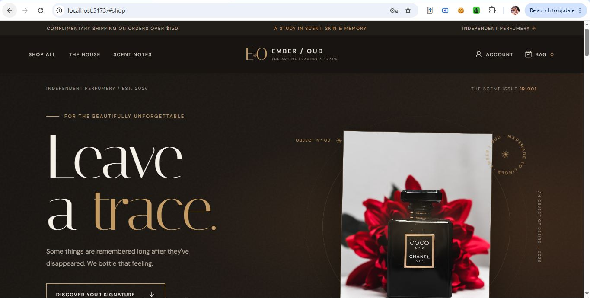
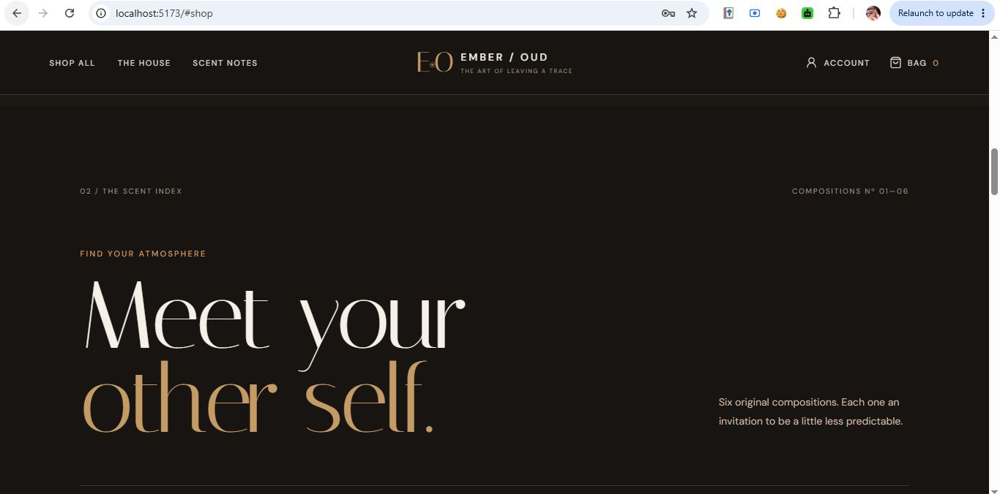
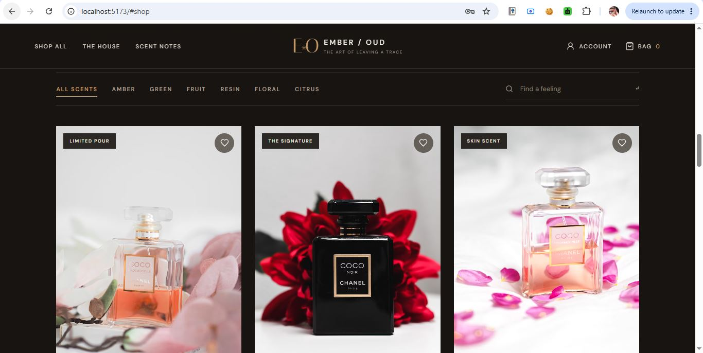
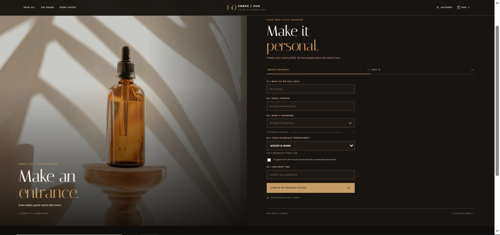
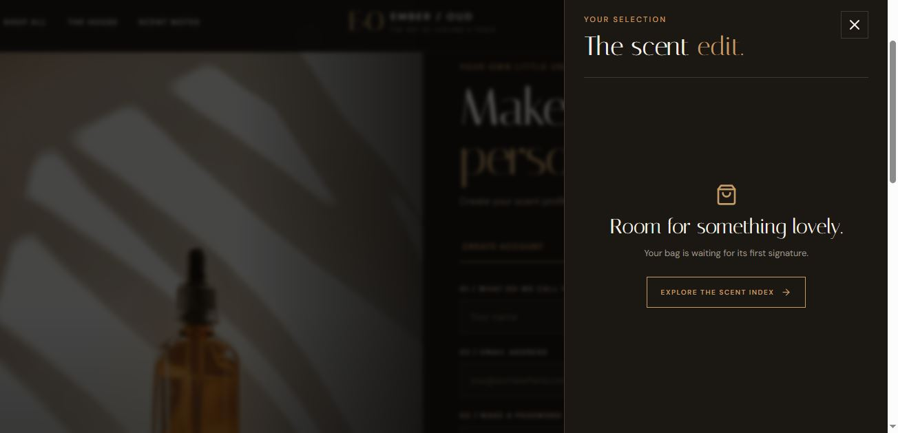
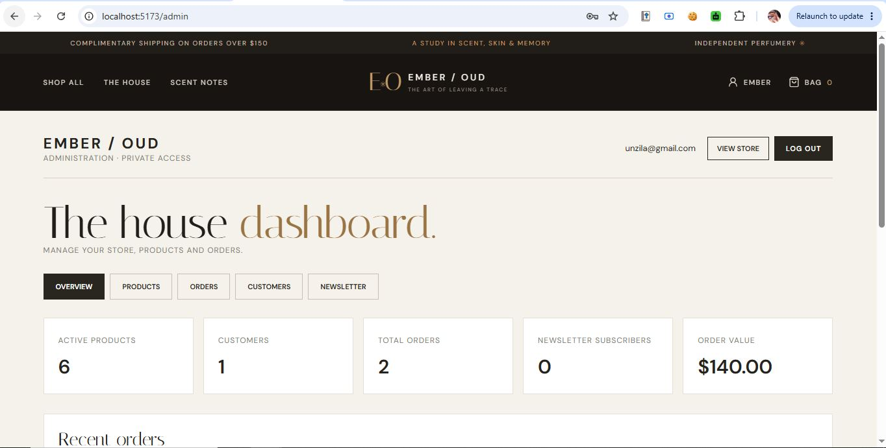

# EMBER / OUD — Full-Stack Perfume E-Commerce

A luxury perfume store built with **React + Vite** (frontend), **Node.js + Express** (REST API) and **MongoDB** (database). Customers can browse and search fragrances, build a bag, register, sign in and place orders. Administrators manage products, orders, customers and newsletter subscribers from a protected dashboard.

Built for **Devixo Solutions — Task 04: Full-Stack E-Commerce / Business Management Application**.

| | |
|---|---|
| **Live store (Netlify)** | https://ember-oud.netlify.app |
| **API (Vercel)** | https://perfume-rho-gules.vercel.app/ |
| **Admin panel** | `<live store>/admin` (admin account only) |

## Screenshots

| Hero | Scent index | Product cards |
|---|---|---|
|  |  |  |

| Create account | Bag drawer | Admin dashboard |
|---|---|---|
|  |  |  |

More images are in [`docs/screenshots`](docs/screenshots).

## Features

**Storefront**
- Responsive, animated UI for mobile, tablet and desktop, with hover effects and a scent-spray animation
- Product catalogue loaded from the API (local fallback catalogue if the API is offline)
- Search ("Find a feeling") and fragrance-family filters
- Shopping bag with quantity controls and free-shipping threshold
- Wishlist (hearts), newsletter subscription stored in the database

**Authentication and security**
- Register, login and logout with JWT sessions
- Passwords hashed with bcrypt (12 rounds); length validation on the client and server
- Protected routes: `/admin` requires the `admin` role, checkout requires sign-in
- Server-side validation, central error handling, Helmet, CORS allow-list and rate limiting
- Order totals and stock are verified on the server; the browser cannot set prices

**Admin dashboard (`/admin`)**
- Statistics: active products, customers, orders, subscribers and order value
- Recent orders table
- Create, read, update and archive products
- View orders and update their status; view customers and newsletter subscribers

## Tech stack

| Layer | Technology |
|---|---|
| Frontend | React 19, Vite 7, React Router, Framer Motion, lucide-react |
| Backend | Node.js, Express 4, Mongoose, JWT, bcryptjs, Helmet, express-rate-limit |
| Database | MongoDB Atlas |
| Hosting | Netlify (frontend), Vercel (backend) |

## Project structure

```text
EMBER-OUD/
├── frontend/              React + Vite app (src/App.jsx, AdminDashboard.jsx, styles.css)
├── backend/
│   ├── api/index.js       Vercel serverless entry
│   ├── config/db.js       Cached MongoDB connection
│   ├── middleware/        auth (JWT, admin role), error handling
│   ├── models/            User, Product, Order, Newsletter
│   ├── routes/            auth, products, orders, newsletter, admin
│   ├── scripts/           seed.js, createAdmin.js
│   ├── server.js          Express app (local server + Vercel export)
│   └── vercel.json
├── docs/screenshots/
├── netlify.toml
└── README.md
```

## Run locally

Requirements: Node.js 20.19+ or 22+, npm, and a MongoDB Atlas database (or local MongoDB).

```bash
# 1. Backend
cd backend
cp .env.example .env        # then fill in MONGO_URI, JWT_SECRET, ADMIN_* values
npm install
npm run seed                # adds the six catalogue products
npm run create-admin        # creates the admin account from ADMIN_EMAIL / ADMIN_PASSWORD
npm run dev                 # http://localhost:5000/api/health

# 2. Frontend (new terminal)
cd frontend
cp .env.example .env
npm install
npm run dev                 # http://localhost:5173
```


### Environment variables

**Backend (`backend/.env`, never commit)**

| Variable | Purpose |
|---|---|
| `MONGO_URI` | MongoDB Atlas connection string |
| `JWT_SECRET` | Long random secret used to sign tokens |
| `JWT_EXPIRES_IN` | Token lifetime, e.g. `7d` |
| `CLIENT_URL` | Allowed frontend origin(s), comma separated, no trailing slash |
| `NODE_ENV` | `development` or `production` |
| `ADMIN_NAME`, `ADMIN_EMAIL`, `ADMIN_PASSWORD` | Used by `npm run create-admin` (password 12+ characters) |

**Frontend (`frontend/.env`)**

| Variable | Purpose |
|---|---|
| `VITE_API_URL` | API base URL, e.g. 'https://perfume-rho-gules.vercel.app/api' |


## API reference

| Method | Endpoint | Access | Purpose |
|---|---|---|---|
| GET | `/api/health` | Public | Service and database check |
| POST | `/api/auth/register` | Public | Register a customer |
| POST | `/api/auth/login` | Public | Sign in (customer or admin) |
| GET / PATCH | `/api/auth/me` | Signed in | Read / update own profile |
| GET | `/api/products` | Public | List with `search`, `family`, `featured`, `page`, `limit` |
| GET | `/api/products/:slug` | Public | Single product |
| POST | `/api/newsletter/subscribe` | Public | Subscribe an email |
| POST | `/api/orders` | Signed in | Place an order |
| GET | `/api/orders/my-orders` | Signed in | Own order history |
| GET | `/api/orders/:id` | Order owner | Single own order |
| GET | `/api/admin/stats` | Admin | Dashboard statistics |
| POST / PATCH / DELETE | `/api/admin/products[/:id]` | Admin | Create / update / archive product |
| GET | `/api/admin/orders` | Admin | List orders |
| PATCH | `/api/admin/orders/:id` | Admin | Update order or payment status |
| GET | `/api/admin/customers` | Admin | List customers |
| GET | `/api/admin/newsletter` | Admin | List subscribers |

## Deployment

The backend runs on **Vercel** and the frontend on **Netlify**. Deploy the backend first.

### 1. Database (MongoDB Atlas)
1. Create a free cluster and a database user.
2. Network Access: allow `0.0.0.0/0` (Vercel uses changing IP addresses).
3. Copy the connection string and add the database name, e.g. `.../ember-oud?retryWrites=true&w=majority`.

### 2. Backend on Vercel
1. Push the repository to GitHub, then in Vercel choose **Add New → Project** and import it.
2. Set **Root Directory** to `backend`. Framework preset: **Other**. Leave build settings empty.
3. Add the environment variables: `MONGO_URI`, `JWT_SECRET`, `JWT_EXPIRES_IN`, `NODE_ENV=production` and `CLIENT_URL` (temporarily `http://localhost:5173`).
4. Deploy and open `https://perfume-rho-gules.vercel.app/`. It should return `"ok": true`.
5. Seed the production database once from your computer, with `backend/.env` pointing at the same Atlas database: `npm run seed` and `npm run create-admin`.

### 3. Frontend on Netlify
1. In Netlify choose **Add new site → Import an existing project** and select the repository.
2. The settings are read from `netlify.toml` (base `frontend`, build `npm run build`, publish `dist`).
3. Add the environment variable `VITE_API_URL = https://perfume-rho-gules.vercel.app/`.
4. Deploy and note the site URL, e.g. `https://ember-oud.netlify.app/`.

### 4. Connect them
In Vercel, change `CLIENT_URL` to the exact Netlify origin (no trailing slash) and **redeploy** the backend. Then test registration, checkout and `/admin` on the live site.

## Scope and limitations
- Checkout records **cash on delivery** or **manual bank transfer** orders only; no card payment gateway is connected.
- Newsletter emails are collected but not sent; there is no email notification service.
- Product images are external URLs (Unsplash); there is no image upload.
- Deleting a product archives it (soft delete) so that past orders stay valid.
- Sessions use a JWT stored in `localStorage`.

## License
Created as a learning and internship project. Product photography belongs to its respective owners via Unsplash.
